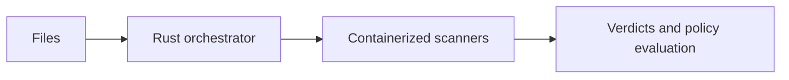

# Local multi-antivirus scanning

**Martin Larsson · Master's thesis · Linköping University · 2026**

*Design and Evaluation of a Local Multi-Antivirus Scanning System: Containerized Orchestration and Performance Analysis of Parallel Antivirus Engines*

## Problem and approach

Offline USB transfer systems cannot rely on cloud scanning. I implemented a proof of concept using a Rust orchestrator and Dockerized scanner plugins, then evaluated throughput, scanner disagreement, and decision policies.

Conceptual overview:

## Findings and limits

The experiments distinguished orchestration concurrency from scanner saturation. In the reported comparison, a cascade any-hit strategy retained the same aggregate outcomes as parallel scanning while reducing batch duration by 27% and engine scans by 58%.

These results concern the evaluated workloads; they do not establish universal malware-detection accuracy. Plugin modularity also required upfront work on adapters, configuration, and observability.

## Read more

This overview summarizes the [public university abstract](https://www.ida.liu.se/divisions/aiics/pubs/studenttheses?abstract=true). See the [thesis record](https://liu.diva-portal.org/smash/record.jsf?pid=diva2:2094652) for the full study. This repository contains the overview only.
